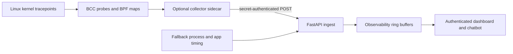

# eBPF integration

## Setup

For the API runtime, see the README's [environment and SQLite fallback notes](../README.md#local-setup). In development, placeholder ingest secrets disable the ingest endpoint with `503`; use the same non-placeholder secret in the API and collector. Production startup requires explicit non-placeholder JWT, initial-admin, and ingest secrets. The active database is reported by `/health` and the authenticated observability status endpoint.

Follow [the eBPF collector README](../ebpf/README.md). On WSL2, verify `uname -r` and `sudo bpftool feature probe kernel` before installing packages. Install with `sudo apt install bpfcc-tools python3-bpfcc linux-headers-$(uname -r) clang`; configure matching `OBSERVABILITY_INGEST_SECRET` values, then start the collector with `BACKEND_PROCESS_NAME=uvicorn`. It automatically resolves the kernel TGID and re-resolves after a backend restart. `BACKEND_PID` is an optional kernel-visible TGID hint; `find_kernel_tgid.py` remains a diagnostic helper.

`docker-compose.ebpf.yml` is an optional development override. It grants host PID visibility and privileged kernel mounts; this is for local demos only. Production should use a dedicated node agent with the smallest possible capabilities and a private authenticated socket.

## Probe mapping and limits

The collector attaches `raw_syscalls:sys_enter` and `sys_exit`; BPF hash maps retain start times and counts, and a histogram map aggregates duration buckets. It also attaches scheduler wakeup/switch for tracked backend tasks, TCP retransmit for a host-wide counter, openat for configured sensitive paths, process-exec for the backend and tracked descendants, and fork/exit to follow and remove child tasks. The verifier rejects unsafe memory access and invalid control flow before loading. The sidecar applies the sensitive-path allowlist in user space and emits only a generic event description, never the path itself. Probe source examples are in `probes/`; active attachments are declared in `collector.py`.

DB latency measures app-side transaction duration, not PostgreSQL server execution time. Kernel sidecar DB round-trip probes, TCP resets/connection failures, remote-address aggregation, and RTT are not implemented. Child processes are tracked recursively, but the API does not expose a full process tree. The system remains functional without BCC. eBPF availability varies by kernel and container permissions. Windows native eBPF and the Docker Compose sidecar were not verified; WSL2 ingest and syscall telemetry were verified as described below.

### Verification status

On 2026-11-24, the API and collector ran inside WSL2 kernel `6.6.114.1-microsoft-standard-WSL2` with temporary credentials and a temporary SQLite database outside the repository. All nine tracepoints loaded. Auto-discovery resolved backend TGID `1475`, then re-resolved `1852` after the API process restarted. Authenticated status reported `collector: "ebpf"` and `active_database: "sqlite"` without requiring the debugging helper.

| Probe | Result |
| --- | --- |
| Syscall enter/exit | **[Working end to end]** Syscall counts and latency reached the API; the dashboard showed syscall IDs and p95. |
| Scheduler wakeup/switch | **[Working end to end]** Run-queue p95 reached the API at 31 µs during and after a 12-second four-worker CPU load. Its p95 did not rise during this short test, so increased latency under load was not demonstrated. |
| TCP retransmit | **[Working end to end]** Twelve closed-localhost-port connects were refused without retransmits; a timed TEST-NET connect changed the host-wide count from 0 to 3. |
| openat sensitive-path filter | **[Working end to end]** Reading only a harmless disposable configured fixture produced a high event with generic details and no path. No real `.env` file was opened. |
| process exec / child tracking | **[Working end to end]** A tracked process spawned `/bin/sh`; a `process_exec` event appeared in authenticated security events. |

The frontend dashboard displayed eBPF active status, SQLite, scheduler and syscall metrics, TCP retransmits, app latency and both security-event types. It correctly showed DB latency as `No DB samples`; eBPF process CPU percentage, TCP resets, and connection-failure counters are unavailable. Docker Compose sidecar behavior and other Linux kernels remain **not verified**. These are single-host smoke checks, not performance benchmarks. See [the eBPF collector README](../ebpf/README.md) for exact commands and test details.

## Demo

1. Start the app and log in; open Observability and confirm the collector badge.
2. On PostgreSQL, run the concurrency panel in safe mode while watching request and DB timing. Row locks make competing transactions wait; SQLite ignores `FOR UPDATE` and cannot demonstrate that effect.
3. Ask the chatbot “why is the app slow right now?” and inspect its live metrics and sources.
4. Optional security-event demo: add a harmless disposable file path to test-only `SENSITIVE_PATHS`, then open it from a tracked process and spawn `/bin/sh`. This WSL2 setup emitted both events. Keep the path private in the configuration and never read host secrets or a real `.env` file.

## Viva Q&A

- **What does the verifier do?** It checks BPF bytecode for safe memory access, bounded execution and valid helper use before loading.
- **Why maps?** They keep aggregation in kernel space and avoid shipping every syscall event to Python.
- **Why a sidecar?** Kernel capabilities stay outside the FastAPI process; the API remains unprivileged.
- **What is the fallback?** App request timing, best-effort psutil process sampling, and available database activity views.
