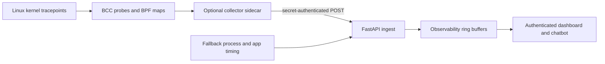

# eBPF integration

## Setup

Follow [the eBPF collector README](../ebpf/README.md). On WSL2, verify `uname -r` and `sudo bpftool feature probe kernel` before installing packages. Install with `sudo apt install bpfcc-tools python3-bpfcc linux-headers-$(uname -r) clang`; configure matching `OBSERVABILITY_INGEST_SECRET` values and launch the sidecar with `sudo -E python3 ebpf/collector.py` after setting `BACKEND_PID`.

`docker-compose.ebpf.yml` is an optional development override. It grants host PID visibility and privileged kernel mounts; this is for local demos only. Production should use a dedicated node agent with the smallest possible capabilities and a private authenticated socket.

## Probe mapping and limits

The collector attaches `raw_syscalls:sys_enter` and `sys_exit`; BPF hash maps retain start times and counts, and a histogram map aggregates duration buckets. It also attaches scheduler wakeup/switch for run-queue latency, TCP retransmit for a host-wide counter, openat for backend file events and process-exec for the backend PID. The verifier rejects unsafe memory access and invalid control flow before loading. The sidecar applies the sensitive-path allowlist in user space and emits only a generic event description, never the path itself. Probe source examples are in `probes/`; active attachments are declared in `collector.py`.

DB latency measures app-side transaction duration, not PostgreSQL server execution time. Kernel sidecar DB round-trip probes, TCP resets/connection failures, remote-address aggregation, child-process ancestry and RTT are not implemented. The system remains functional without BCC. eBPF availability varies by kernel and container permissions. Windows native eBPF was not verified; a WSL2 Linux kernel was used for the load check.

### Verification status

The probes compiled and attached successfully on WSL2 kernel `6.6.114.1-microsoft-standard-WSL2` during the IntelliStock release audit. The collector then failed to publish because the API was not running (`connection refused`). Probe compilation/attachment was verified, but end-to-end ingest, live event delivery, and dashboard rendering in eBPF mode were **not verified**. The Docker Compose sidecar path was not verified. For end-to-end verification on WSL2/Linux, start the API with a non-placeholder `OBSERVABILITY_INGEST_SECRET`, find the actual API worker PID with `pgrep -af 'uvicorn app.main:app'`, and run the collector command above using that PID and the same secret. Then check authenticated `GET http://127.0.0.1:8000/api/observability/status` for `collector: "ebpf"` and an advancing `last_update`; generate a harmless API request and inspect `GET /api/observability/metrics`.

## Demo

1. Start the app and log in; open Observability and confirm the collector badge.
2. On PostgreSQL, run the concurrency panel in safe mode while watching request and DB timing. Row locks make competing transactions wait; SQLite ignores `FOR UPDATE` and cannot demonstrate that effect.
3. Ask the chatbot “why is the app slow right now?” and inspect its live metrics and sources.
4. With the security probe extended and its path policy configured, read a sensitive file from the monitored backend process and inspect the resulting event. Do not read host secrets for a demo; use a disposable test path.

## Viva Q&A

- **What does the verifier do?** It checks BPF bytecode for safe memory access, bounded execution and valid helper use before loading.
- **Why maps?** They keep aggregation in kernel space and avoid shipping every syscall event to Python.
- **Why a sidecar?** Kernel capabilities stay outside the FastAPI process; the API remains unprivileged.
- **What is the fallback?** App request timing, best-effort psutil process sampling, and available database activity views.
