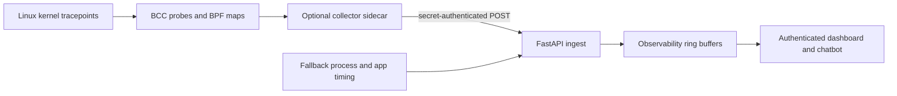

# eBPF integration

## Setup

For the API runtime, see the README's [environment and SQLite fallback notes](../README.md#local-setup). In development, placeholder ingest secrets disable the ingest endpoint with `503`; use the same non-placeholder secret in the API and collector. Production startup requires explicit non-placeholder JWT, initial-admin, and ingest secrets. The active database is reported by `/health` and the authenticated observability status endpoint.

Follow [the eBPF collector README](../ebpf/README.md). On WSL2, verify `uname -r` and `sudo bpftool feature probe kernel` before installing packages. Install with `sudo apt install bpfcc-tools python3-bpfcc linux-headers-$(uname -r) clang`; configure matching `OBSERVABILITY_INGEST_SECRET` values, run `sudo python3 ebpf/find_kernel_tgid.py --comm uvicorn --duration 3`, and set `BACKEND_PID` to the emitted kernel TGID before starting the collector.

`docker-compose.ebpf.yml` is an optional development override. It grants host PID visibility and privileged kernel mounts; this is for local demos only. Production should use a dedicated node agent with the smallest possible capabilities and a private authenticated socket.

## Probe mapping and limits

The collector attaches `raw_syscalls:sys_enter` and `sys_exit`; BPF hash maps retain start times and counts, and a histogram map aggregates duration buckets. It also attaches scheduler wakeup/switch for run-queue latency, TCP retransmit for a host-wide counter, openat for backend file events and process-exec for the backend PID. The verifier rejects unsafe memory access and invalid control flow before loading. The sidecar applies the sensitive-path allowlist in user space and emits only a generic event description, never the path itself. Probe source examples are in `probes/`; active attachments are declared in `collector.py`.

DB latency measures app-side transaction duration, not PostgreSQL server execution time. Kernel sidecar DB round-trip probes, TCP resets/connection failures, remote-address aggregation, child-process ancestry and RTT are not implemented. The system remains functional without BCC. eBPF availability varies by kernel and container permissions. Windows native eBPF and the Docker Compose sidecar were not verified; WSL2 ingest and syscall telemetry were verified as described below.

### Verification status

On 2026-11-24, the collector loaded all seven probes and published authenticated telemetry on WSL2 kernel `6.6.114.1-microsoft-standard-WSL2`. The first attempt with the distro PID from `pgrep` produced empty syscall maps. The BCC helper found kernel TGID `3390` for the API process (while `pgrep` showed distro PID `317`); setting `BACKEND_PID` to the kernel TGID fixed this. After safe and unsafe sale requests, authenticated status showed `collector: "ebpf"`, seven loaded probes, and the API metrics returned 7,237 syscall counts across 25 syscall IDs plus two app-side DB timing samples. This is one smoke run, not a benchmark.

The scheduler probe loaded, but its run-queue measurement was not verified. TCP retransmits stayed at zero and none were induced. The openat and process-exec probes loaded, but an event from the API process was not confirmed and no actual `.env` file was read. Dashboard rendering in eBPF mode and the Docker Compose sidecar remain **not verified**. See the WSL2 commands and per-probe notes in [the eBPF collector README](../ebpf/README.md).

## Demo

1. Start the app and log in; open Observability and confirm the collector badge.
2. On PostgreSQL, run the concurrency panel in safe mode while watching request and DB timing. Row locks make competing transactions wait; SQLite ignores `FOR UPDATE` and cannot demonstrate that effect.
3. Ask the chatbot “why is the app slow right now?” and inspect its live metrics and sources.
4. Optional security-event demo: use a disposable test file and a dedicated monitored test process. The current API process was not verified to emit openat or process-exec events; do not present those events as tested. Never read host secrets or a real `.env` file.

## Viva Q&A

- **What does the verifier do?** It checks BPF bytecode for safe memory access, bounded execution and valid helper use before loading.
- **Why maps?** They keep aggregation in kernel space and avoid shipping every syscall event to Python.
- **Why a sidecar?** Kernel capabilities stay outside the FastAPI process; the API remains unprivileged.
- **What is the fallback?** App request timing, best-effort psutil process sampling, and available database activity views.
